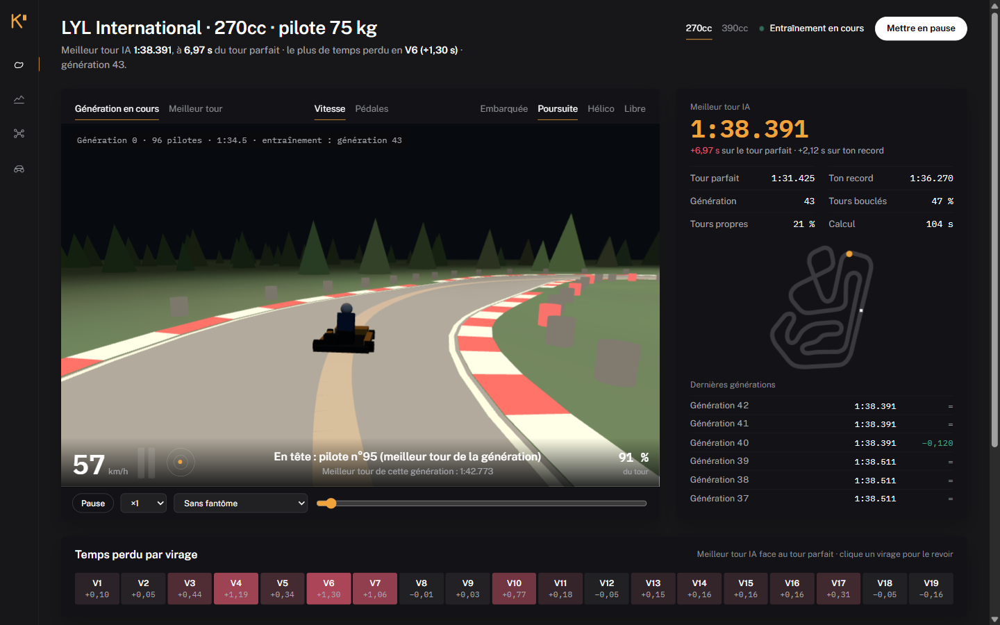
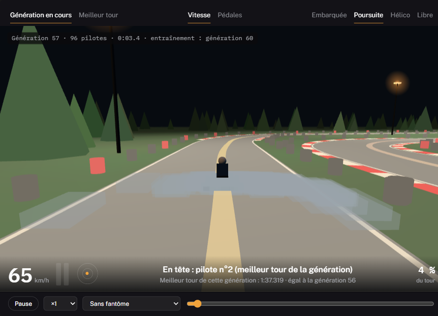
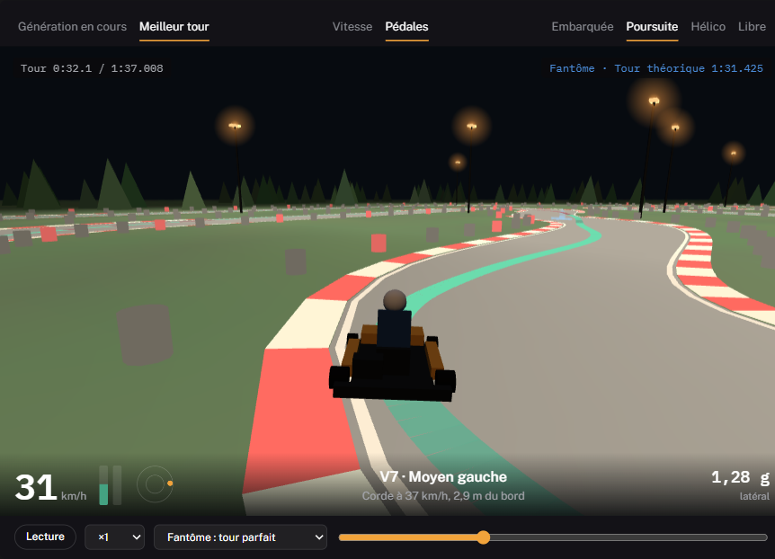
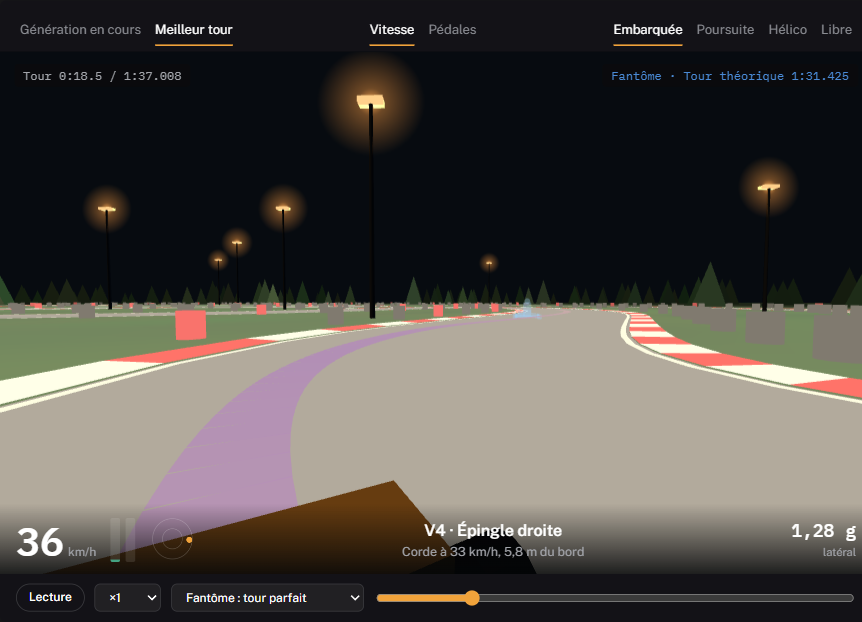
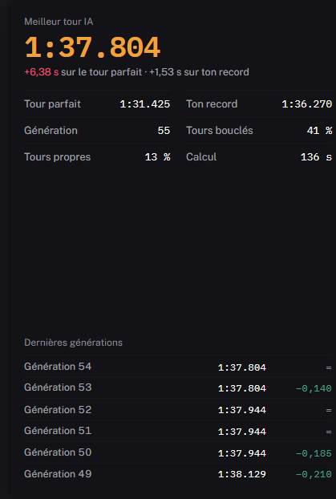
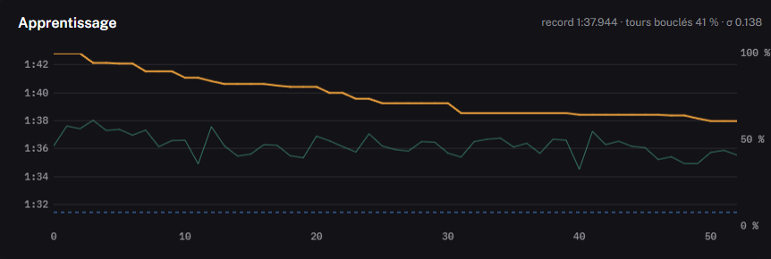
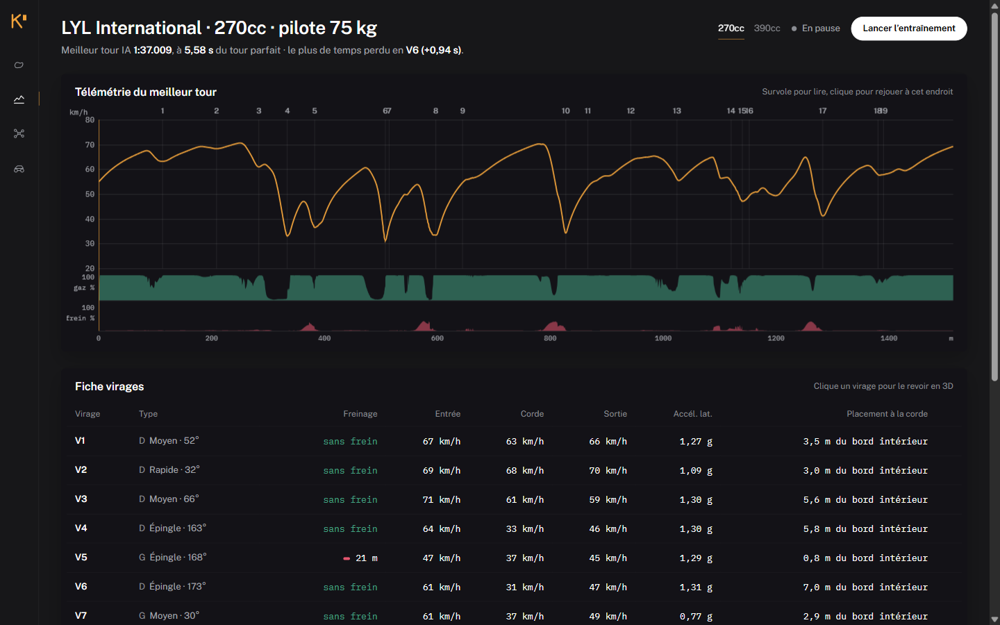
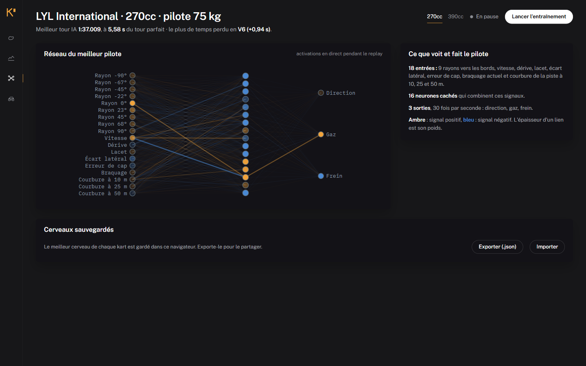
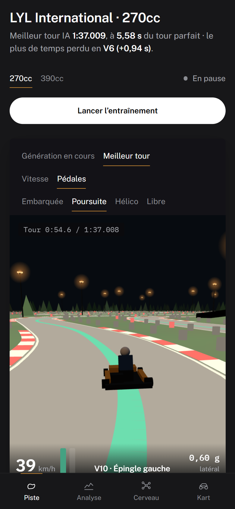

# Kart Lap Lab

**Des pilotes à réseau de neurones apprennent à boucler un circuit de karting** en kart de location 270cc ou 390cc, génération après génération, dans le navigateur. Circuit de référence : le LYL International Karting Circuit (Sungai Long, Kajang, Malaisie), plus huit pistes connues d'Europe. On les regarde progresser en 3D de nuit, puis on étudie le meilleur tour pour savoir où freiner, où remettre les gaz et par où passer.



## Ce qu'on y voit

| | |
|---|---|
|  | **Entraînement en direct.** Toute la génération roule en même temps : les pilotes en gris, celui qui mène en ambre, suivi par la caméra. Le HUD donne le meilleur tour de la génération et le gain sur la précédente. En rythme **Chaque génération** (par défaut), l'entraînement attend qu'on ait vu chaque génération rouler : on voit les débutants de la génération 1 puis chaque progrès (« Génération suivante » passe les retardataires). En **Accéléré**, l'entraînement va à pleine vitesse et « Voir la dernière génération » rattrape la vue. |
|  | **Meilleur tour.** Replay avec quatre caméras (embarquée, poursuite, hélico, libre), le HUD (vitesse, pédales, g-mètre, prochain virage) et un fantôme : le tour parfait, la génération N−50 ou l'autre kart. La trajectoire se colore par vitesse ou par pédales (vert = gaz, rouge = frein, intensité = dosage). |
|  | **Caméra embarquée.** Ce que voit le pilote, avec le conseil du prochain virage : où freiner, à quelle vitesse passer la corde. |
|  | **Chronométrage.** Meilleur tour IA, écart au tour parfait et à ton record, plan du circuit avec la position du kart, et le meilleur tour des dernières générations : il ne recule jamais. |
|  | **Apprentissage.** Le record (ambre) par génération, le taux de tours bouclés (vert) et le tour parfait (pointillé). |



**Analyse.** Vitesse, gaz et frein le long du tour face au tour parfait, et pour chacun des 19 virages : distance de freinage, vitesses d'entrée, de corde et de sortie, accélération latérale, placement et temps perdu. Un clic rejoue le passage en 3D.

| | |
|---|---|
|  |  |
| **Cerveau.** Le réseau du meilleur pilote, avec ses activations en direct pendant le replay. | **Sur téléphone.** Même application, navigation en bas d'écran. |

## Circuits

| Circuit | Lieu | Longueur |
|---|---|---|
| LYL International | Sungai Long, Malaisie (avec pont) | 1 514 m |
| Adria Karting Raceway | Adria, Italie | 1 302 m |
| Karting Genk | Genk, Belgique | 1 360 m |
| Åsum Ring | Kristianstad, Suède | 1 221 m |
| Le Mans Karting International | Le Mans, France (anti-horaire) | 1 384 m |
| PFi | Brandon, Royaume-Uni (avec pont) | 1 382 m |
| Circuito Internazionale Napoli | Sarno, Italie | 1 670 m |
| South Garda Karting | Lonato, Italie | 1 200 m |
| Circuito Internacional de Zuera | Zuera, Espagne | 1 700 m |

Le circuit se choisit en haut de la page (ou avec `?c=genk` dans l'adresse). Chaque circuit a son habillage : couleurs du pays, et un décor dessiné d'après le lieu, en en-tête et à l'horizon de la 3D (tours Petronas vues de Kajang, pont Dunlop au Mans, chevalements de mine à Genk, Vésuve à Sarno, moulin de Heckington près de PFi…). Chaque circuit garde son meilleur cerveau et ton record, à saisir dans la vue Kart. Le kart reste un kart de location : les records publics de ces pistes, faits en karts de compétition, ne sont pas comparables.

## Météo et heure

La météo se choisit à côté du circuit : **sec**, **piste grasse** (poussière, huile, piste verte sans gomme), **humide** (piste qui sèche) ou **pluie**. Elle change la physique : adhérence de l'asphalte (−12 %, −25 %, −40 %), vibreurs et herbe bien plus glissants, eau qui freine les roues. Chaque condition a son propre cerveau, qui démarre du pilote du sec. Sur un circuit encore jamais entraîné, les pilotes partent de zéro : on les voit apprendre à conduire. « Repartir de zéro » relance une population vierge sans effacer le record, qui n'est remplacé que s'il est battu. Le **pilote généraliste** (`data/brains/generaliste-k270.json`), entraîné 20 minutes sur les 9 circuits à la fois, boucle déjà un tour partout (1:32.6 au LYL, 1:20.2 au Mans, 1:16.6 à Adria) : il sert de témoin ou de point de départ si on le choisit.

**Pilotes invités** (vue Piste, étape 3 du guide) : chaque pilote entraîné sur un autre circuit avec le même kart, plus le généraliste, est testé tel quel sur le circuit affiché (tour bouclé, ou distance parcourue avant de sortir). **Faire rouler ici** le fait rouler en fantôme bleu, en replay comme à côté de la population pendant l'entraînement ; **Partir de lui** lance le prochain entraînement à partir de ce pilote au lieu de débutants. La vue Analyse compare le tour parfait et le meilleur tour IA dans chaque condition ; sur le LYL en 270cc, la pluie coûte environ 16 s (+17 %) au tour parfait.

Le curseur **Heure** fait passer la piste de la nuit (projecteurs au sodium) au jour, par le lever et le coucher du soleil. C'est un réglage d'affichage : la physique ne voit pas l'heure.

## Lancer

```bash
npm install
npm run dev        # http://localhost:5173
```

Clique **Lancer l'entraînement**. La première génération ne sait pas rouler : les pilotes découvrent la piste et sortent presque tous. Le premier tour bouclé arrive après une vingtaine de générations ; laisse tourner quelques minutes pour voir le temps descendre. Le meilleur cerveau est gardé dans le navigateur, et s'exporte en JSON depuis la vue Cerveau.

```bash
npm test           # 81 tests : physique, circuits, IA, non-régression v1, calage
npm run test:slow  # non-régression complète de la v1 (≈ 1 min)
npm run build      # site statique dans dist/
npx tsx scripts/train-headless.ts --track genk --kart k270 --minutes 10   # entraînement sans interface
npx tsx scripts/train-headless.ts --weather pluie --x0 <cerveau.json>     # sous la pluie, à partir d'un cerveau
npx tsx scripts/train-headless.ts --others all --minutes 20               # pilote généraliste, tous les circuits
npx tsx scripts/train-headless.ts --others all --hidden 32 --x0 <cerveau.json>  # réseau élargi à partir d'un cerveau existant
npx tsx scripts/train-headless.ts --eval <cerveau.json>                   # tour lancé sur chaque circuit
```


## Comment ça marche

**La physique** tourne à 120 Hz, de façon déterministe : pneus Pacejka simplifiés, essieu arrière rigide, frein arrière seul qui peut bloquer, roue intérieure qui se soulève en virage serré, transfert de charge, pente du pont, herbe, vibreurs, murs de pneus. Un tête-à-queue est possible.

**Le pilote** est un réseau de neurones 20-32-3. Il reçoit 9 rayons vers les bords de piste, sa vitesse, sa dérive, son lacet, son écart latéral, son erreur de cap, son braquage actuel, la courbure de la piste à 10, 25 et 50 m, son accélération et sa pédale de frein. Rien ne lui dit à quelle vitesse passer un virage : comme un amateur sur un circuit inconnu, il le découvre en essayant. Ça rend aussi la comparaison entre circuits honnête : un pilote invité n'apporte que ce qu'il a appris ailleurs.

**Limites de piste** : les vibreurs font partie de la piste. Un tour bouclé avec une roue dans l'herbe n'a pas de chrono (il ne compte ni pour le record ni pour l'apprentissage), comme un tour supprimé en course ; quatre roues dans l'herbe plus d'une demi-seconde arrêtent l'essai. Un pilote trop lent pour finir le tour dans le temps imparti est aussi arrêté. Il décide 30 fois par seconde de la direction, du gaz et du frein, avec l'inertie des mains sur le volant. Comme un vrai pilote, il n'a qu'un pied droit : dès qu'il freine, il lâche les gaz.

**L'apprentissage** est une neuroévolution (sep-CMA-ES) : à chaque génération, 256 variantes du cerveau roulent en parallèle dans des Web Workers ; les meilleures orientent la génération suivante. Le meilleur pilote reroule à chaque génération, donc le record ne recule jamais. D'abord finir le tour, ensuite aller vite ; scier le volant ou tapoter les pédales coûte des points.

**Le tour parfait** est une référence quasi-statique : la meilleure trajectoire trouvée pour ce kart réduit à un point, avec son adhérence, son moteur et son freinage. Il sert de fantôme et de référence pour le temps perdu par virage ; un pilote bien entraîné dans le modèle complet peut le battre de quelques dixièmes.

**La fiche virages** donne aussi la technique : la part du freinage faite en tournant déjà (freinage dégressif) et le dosage maximal, et l'équilibre du volant (neutre, sous-vire, survire) avec la dérive maximale.

## Calage et hypothèses

Avec les données d'un kart de location (9 ch, 62 km/h, µ 1,15), même un pilote parfait ne descend pas sous 1:43, alors que les chronos réels au LYL sont de 1:32 à 1:36 en 270cc (un tour en 1:33.33 relevé à 57,5 km/h de moyenne). Le kart est donc calé pour que le tour parfait fasse **1:31.5**, juste sous les meilleurs chronos connus, avec µ 1,3 et environ 9,9 ch effectifs.

La vitesse de pointe (80 km/h) et la transmission (variateur) sont des hypothèses. Une trace GPS d'un tour réel (RaceChrono, par exemple) permettrait de les caler, et de comparer ta trajectoire à celle de l'IA virage par virage. La vue Kart permet de recaler le modèle sur un autre temps.

## Ajouter un circuit

1. Récupère le tracé d'un tour complet dans le sens de roulage : trace GPX, LineString GeoJSON, ou réponse Overpass (`out body geom`).
2. Crée `data/tracks/<id>.json` au format `TrackDef` (voir `src/track/types.ts`) : `id`, `name`, `coords` en `[lat, lon]`, `width`, et si besoin `officialLength` (avec sa source dans `lengthSource`), `bridge` et `startFrac`. `parseTrackFile()` (`src/track/import.ts`) convertit les trois formats. Le fichier est repris automatiquement par le sélecteur et par les tests.
3. Depuis OpenStreetMap : mets les ways du tracé dans `osm.ways` (et le premier dans `osm.main`), puis `npx tsx scripts/fetch-osm.ts --track <id> --write` les raccorde dans le sens de roulage et remplit `coords`.

## Organisation du code

| Dossier | Rôle |
|---|---|
| `src/track/` | Format de circuit, import GPX/GeoJSON/Overpass, géométrie, virages, pont, requêtes spatiales |
| `src/sim/` | Physique pure (sans DOM) : modèle dynamique, moteur, tour parfait, calage, solveur et AG de la v1 |
| `src/ai/` | Réseau, capteurs, épisodes, sep-CMA-ES, pool de workers, enregistrement des tours |
| `src/workers/` | Workers du navigateur : simulation et outils (replay, tour parfait, calage) |
| `src/ui/` | Interface : vues, scène 3D (Three.js), graphiques, réseau |
| `data/tracks/` | Circuits au format `TrackDef` |
| `legacy/` | La v1, intacte (lien depuis la vue Kart) |

## Crédits

Tracé du circuit : © contributeurs [OpenStreetMap](https://www.openstreetmap.org/copyright), sous licence ODbL.
